

<picture>
  <source media="(prefers-color-scheme: dark)" srcset="https://raw.githubusercontent.com/Rudrasamadhiya/Rudrasamadhiya/main/assets/hero-dark.svg?v=3"/>
  <source media="(prefers-color-scheme: light)" srcset="https://raw.githubusercontent.com/Rudrasamadhiya/Rudrasamadhiya/main/assets/hero-light.svg?v=3"/>
  
</picture>

<picture>
  <source media="(prefers-color-scheme: dark)" srcset="https://raw.githubusercontent.com/Rudrasamadhiya/Rudrasamadhiya/main/assets/stats-dark.svg?v=3"/>
  <source media="(prefers-color-scheme: light)" srcset="https://raw.githubusercontent.com/Rudrasamadhiya/Rudrasamadhiya/main/assets/stats-light.svg?v=3"/>
  
</picture>

 

<picture>
  <source media="(prefers-color-scheme: dark)" srcset="https://raw.githubusercontent.com/Rudrasamadhiya/Rudrasamadhiya/main/assets/h01-dark.svg?v=3"/>
  <source media="(prefers-color-scheme: light)" srcset="https://raw.githubusercontent.com/Rudrasamadhiya/Rudrasamadhiya/main/assets/h01-light.svg?v=3"/>
  
</picture>

I'm Rudra — a **CSE (Data Science) undergrad at IIIT Bhopal** who would rather ship than talk about shipping. I like building the whole thing: the product, the backend that keeps it standing, and the boring pipelines nobody sees.

- **Now** — growing [PrepSharp.in](https://prepsharp.in): study-planning engine, PYQ pipeline and the Android app
- **Building** — open-source bridges that let AI agents (Claude Code, Cursor, Antigravity) see and drive real phones
- **Portfolio** — [rudrasamadhiya.github.io/profile](https://rudrasamadhiya.github.io/profile/), a 3D site you scroll *through*
- **Strong in** — DSA, OOP, OS, DBMS, backend & distributed-system design
- **Off-keyboard** — CTFs with team *Ctrl Alt Defend*, hackathons, and occasionally sleeping
- **Open to** — SWE internships & interesting collaborations · [say hi](mailto:Samadhiyarudra123@gmail.com)

 

<picture>
  <source media="(prefers-color-scheme: dark)" srcset="https://raw.githubusercontent.com/Rudrasamadhiya/Rudrasamadhiya/main/assets/h02-dark.svg?v=3"/>
  <source media="(prefers-color-scheme: light)" srcset="https://raw.githubusercontent.com/Rudrasamadhiya/Rudrasamadhiya/main/assets/h02-light.svg?v=3"/>
  
</picture>

AI coding agents can write your app, but they can't *see* it. So I built the bridges — three open-source packages that give agents eyes and hands on a **real phone**.

| Package | What it does | |
|:--|:--|:--|
| [**android-agent-bridge**](https://github.com/Rudrasamadhiya/android-agent-bridge) · Kotlin + TS | Hand your agent a whole Android phone: screenshots with numbered elements, on-device OCR, taps, typing, device controls and AirDrop-style file transfer. 27 MCP tools, one `npx`, one QR scan. · [docs](https://rudrasamadhiya.github.io/android-agent-bridge/) |   |
| [**expo-mcp-bridge**](https://github.com/Rudrasamadhiya/expo-mcp-bridge) · MCP server | Eyes and hands inside your Expo app on iPhone or Android: snapshot, tap, type, scroll through real handlers, then read the console errors and failed requests each action caused. |   |
| [**expo-launch-video**](https://github.com/Rudrasamadhiya/expo-launch-video) · agent-directed video | Ask for a launch video: the agent films your live app, picks the best takes, writes captions and cuts it with motion graphics. Export a 1080p MP4 from a promptable studio. |   |

→ [expo agent kit docs](https://rudrasamadhiya.github.io/expo-agent-kit/)

 

<picture>
  <source media="(prefers-color-scheme: dark)" srcset="https://raw.githubusercontent.com/Rudrasamadhiya/Rudrasamadhiya/main/assets/h03-dark.svg?v=3"/>
  <source media="(prefers-color-scheme: light)" srcset="https://raw.githubusercontent.com/Rudrasamadhiya/Rudrasamadhiya/main/assets/h03-light.svg?v=3"/>
  
</picture>

<a href="https://prepsharp.in"><picture>
  <source media="(prefers-color-scheme: dark)" srcset="https://raw.githubusercontent.com/Rudrasamadhiya/Rudrasamadhiya/main/assets/card-prepsharp-dark.svg?v=2"/>
  <source media="(prefers-color-scheme: light)" srcset="https://raw.githubusercontent.com/Rudrasamadhiya/Rudrasamadhiya/main/assets/card-prepsharp-light.svg?v=2"/>
  
</picture></a>
<a href="https://github.com/Rudrasamadhiya/instant-kirana"><picture>
  <source media="(prefers-color-scheme: dark)" srcset="https://raw.githubusercontent.com/Rudrasamadhiya/Rudrasamadhiya/main/assets/card-kirana-dark.svg?v=2"/>
  <source media="(prefers-color-scheme: light)" srcset="https://raw.githubusercontent.com/Rudrasamadhiya/Rudrasamadhiya/main/assets/card-kirana-light.svg?v=2"/>
  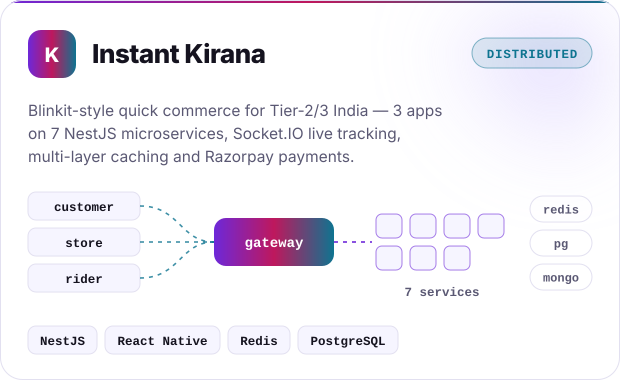
</picture></a>

<a href="https://github.com/Rudrasamadhiya"><picture>
  <source media="(prefers-color-scheme: dark)" srcset="https://raw.githubusercontent.com/Rudrasamadhiya/Rudrasamadhiya/main/assets/card-flowlink-dark.svg?v=2"/>
  <source media="(prefers-color-scheme: light)" srcset="https://raw.githubusercontent.com/Rudrasamadhiya/Rudrasamadhiya/main/assets/card-flowlink-light.svg?v=2"/>
  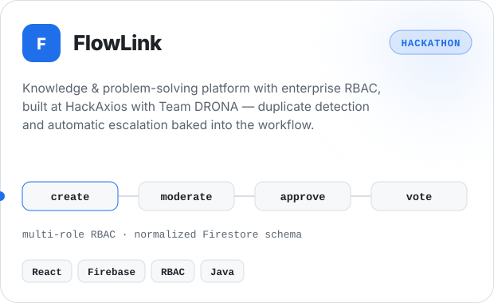
</picture></a>
<a href="https://github.com/Rudrasamadhiya/POSSystem"><picture>
  <source media="(prefers-color-scheme: dark)" srcset="https://raw.githubusercontent.com/Rudrasamadhiya/Rudrasamadhiya/main/assets/card-pos-dark.svg?v=2"/>
  <source media="(prefers-color-scheme: light)" srcset="https://raw.githubusercontent.com/Rudrasamadhiya/Rudrasamadhiya/main/assets/card-pos-light.svg?v=2"/>
  
</picture></a>

 

<picture>
  <source media="(prefers-color-scheme: dark)" srcset="https://raw.githubusercontent.com/Rudrasamadhiya/Rudrasamadhiya/main/assets/h04-dark.svg?v=3"/>
  <source media="(prefers-color-scheme: light)" srcset="https://raw.githubusercontent.com/Rudrasamadhiya/Rudrasamadhiya/main/assets/h04-light.svg?v=3"/>
  
</picture>

**GSSoC '26 Power Contributor** — 10+ merged PRs across community projects. A few I'm proud of:

| Project | What I did |
|:--|:--|
| [**Cara**](https://github.com/janavipandole/Cara/pulls?q=is%3Apr+author%3ARudrasamadhiya) · e-commerce | Merged security & bug fixes — XSS sanitisation, password hashing, price-sort logic |
| [**DailyForge**](https://github.com/aryandas2911/DailyForge/pull/1005) · MERN productivity app | Merged bug-fix PR [#1005](https://github.com/aryandas2911/DailyForge/pull/1005) |
| [**FindMyGSoC**](https://github.com/S3DFX-CYBER/FindMyGSoC/pulls?q=is%3Apr+author%3ARudrasamadhiya) · GSoC org finder | Null-guard and filter-state bug fixes |
| [**hybrid-recommender**](https://github.com/leonagoel/hybrid-recommender/pulls?q=is%3Apr+author%3ARudrasamadhiya) · ML recommender | Performance optimisations and API fixes |

→ [all my merged PRs](https://github.com/search?q=author%3ARudrasamadhiya+is%3Apr+is%3Amerged&type=pullrequests)

 

<picture>
  <source media="(prefers-color-scheme: dark)" srcset="https://raw.githubusercontent.com/Rudrasamadhiya/Rudrasamadhiya/main/assets/h05-dark.svg?v=3"/>
  <source media="(prefers-color-scheme: light)" srcset="https://raw.githubusercontent.com/Rudrasamadhiya/Rudrasamadhiya/main/assets/h05-light.svg?v=3"/>
  
</picture>

<picture>
  <source media="(prefers-color-scheme: dark)" srcset="https://skillicons.dev/icons?i=ts%2Cjs%2Creact%2Cnextjs%2Ctailwind%2Cnodejs%2Cnestjs%2Cexpo%2Cthreejs%2Cpostgres%2Cmongodb%2Credis%2Cfirebase%2Cdocker%2Cjava%2Ckotlin%2Ccpp%2Cpy%2Cgit%2Cgithub%2Cvercel%2Clinux%2Cvscode%2Cpostman%2Candroidstudio%2Chtml%2Ccss&perline=14&theme=dark"/>
  <source media="(prefers-color-scheme: light)" srcset="https://skillicons.dev/icons?i=ts%2Cjs%2Creact%2Cnextjs%2Ctailwind%2Cnodejs%2Cnestjs%2Cexpo%2Cthreejs%2Cpostgres%2Cmongodb%2Credis%2Cfirebase%2Cdocker%2Cjava%2Ckotlin%2Ccpp%2Cpy%2Cgit%2Cgithub%2Cvercel%2Clinux%2Cvscode%2Cpostman%2Candroidstudio%2Chtml%2Ccss&perline=14&theme=light"/>
  
</picture>

 

<picture>
  <source media="(prefers-color-scheme: dark)" srcset="https://raw.githubusercontent.com/Rudrasamadhiya/Rudrasamadhiya/main/assets/h06-dark.svg?v=3"/>
  <source media="(prefers-color-scheme: light)" srcset="https://raw.githubusercontent.com/Rudrasamadhiya/Rudrasamadhiya/main/assets/h06-light.svg?v=3"/>
  
</picture>

<picture>
  <source media="(prefers-color-scheme: dark)" srcset="https://raw.githubusercontent.com/Rudrasamadhiya/Rudrasamadhiya/output/stats-dark.svg"/>
  <source media="(prefers-color-scheme: light)" srcset="https://raw.githubusercontent.com/Rudrasamadhiya/Rudrasamadhiya/output/stats-light.svg"/>
  
</picture>
<picture>
  <source media="(prefers-color-scheme: dark)" srcset="https://raw.githubusercontent.com/Rudrasamadhiya/Rudrasamadhiya/output/langs-dark.svg"/>
  <source media="(prefers-color-scheme: light)" srcset="https://raw.githubusercontent.com/Rudrasamadhiya/Rudrasamadhiya/output/langs-light.svg"/>
  
</picture>

<picture>
  <source media="(prefers-color-scheme: dark)" srcset="https://streak-stats.demolab.com?user=Rudrasamadhiya&background=0F1319&border=252B36&stroke=252B36&ring=5B9DFF&fire=5B9DFF&currStreakNum=E6EDF3&currStreakLabel=5B9DFF&sideNums=E6EDF3&sideLabels=8B949E&dates=8B949E&border_radius=16"/>
  <source media="(prefers-color-scheme: light)" srcset="https://streak-stats.demolab.com?user=Rudrasamadhiya&background=FFFFFF&border=D8DEE4&stroke=D8DEE4&ring=1F6FEB&fire=1F6FEB&currStreakNum=1F2328&currStreakLabel=1F6FEB&sideNums=1F2328&sideLabels=59636E&dates=59636E&border_radius=16"/>
  
</picture>

<picture>
  <source media="(prefers-color-scheme: dark)" srcset="https://raw.githubusercontent.com/Rudrasamadhiya/Rudrasamadhiya/output/github-contribution-grid-snake-dark.svg"/>
  
</picture>

 

<picture>
  <source media="(prefers-color-scheme: dark)" srcset="https://raw.githubusercontent.com/Rudrasamadhiya/Rudrasamadhiya/main/assets/footer-dark.svg?v=2"/>
  <source media="(prefers-color-scheme: light)" srcset="https://raw.githubusercontent.com/Rudrasamadhiya/Rudrasamadhiya/main/assets/footer-light.svg?v=2"/>
  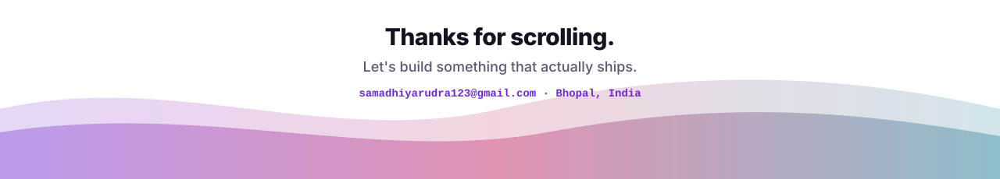
</picture>
